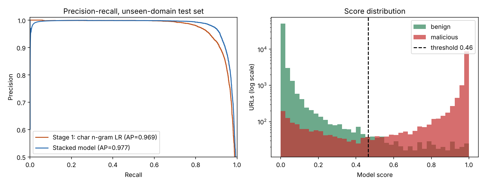

# urlguard — Malicious URL Detection, from Notebook to Production

An end-to-end machine-learning project that **detects malicious URLs** (phishing, malware, defacement) from the URL string alone, and ships the model like production software. Data versioning, leakage-aware evaluation, a stacked model, a tuned decision threshold, a **FastAPI** service with explanations, **Prometheus** metrics, a multi-stage **Docker** image, and **GitHub Actions** CI with a model-quality gate.

    

## Results (406,880 URLs, tested on domains never seen in training)

| Model | PR-AUC | F1 | Precision | Recall | False positive rate | Recall @ 1% FPR |
|---|---|---|---|---|---|---|
| Stage 1: char n-gram TF-IDF + logistic regression | 0.969 | 0.906 | 0.952 | 0.865 | 0.97% | 0.867 |
| **Stacked model** (stage 1 + 25 lexical features, gradient boosting) | **0.978** | **0.934** | 0.957 | **0.912** | 0.91% | **0.916** |

Stacking cut missed malicious URLs from 1,734 to 1,128 (**−35%**), with fewer false alarms than stage 1 at 0.5 (523 vs 558). The threshold (0.464) was chosen on a separate validation set, not the test set. The API answers in **3.8 ms** (p50) for a single URL and **20 ms** for a batch of 500 on a 2-core CPU.



## The interesting part: not fooling yourself

Getting 98% on a URL dataset is easy. Making the number mean something is the real work.

**1. A label shortcut in the raw data.** `www.` appears in 3% of malicious URLs and **0%** of benign ones, so a model can "learn" that `www.` means malicious. Every URL is normalised (scheme, `www.` and trailing `/` stripped, host lower-cased) **in one function used by both training and the API**, so the shortcut is gone and there's no train/serve skew.

**2. Random splits leak.** In a random 80/20 split, **78% of test URLs come from a domain that is also in training** (thousands of `wikipedia.org` pages, for example). The model is rewarded for memorising domains:

| Split | Test rows whose domain was seen in training | PR-AUC | F1 |
|---|---|---|---|
| Random (what most tutorials do) | 78% | 0.986 | 0.945 |
| **Grouped by registered domain** (used here) | **0%** | 0.969 | 0.908 |

All reported numbers use the honest domain-grouped split, because in production every new phishing site is a domain the model has never seen.

**3. Stacking without leakage.** The stage-2 model learns from stage-1 scores. If those scores came from a model that had seen the same rows, they would be over-confident and stage 2 would trust them too much. Stage-1 scores for training are therefore **out-of-fold predictions from `GroupKFold` by domain**.

**4. Thresholds don't transfer perfectly.** An early version tuned the threshold for a 1% false positive rate on validation. It hit 1.0% there and **1.8% on test**. A few large benign domains dominate the false positives, so FPR estimates vary a lot between domain samples. The F1-optimal threshold proved more stable (validation 0.58% → test 0.91%). Both policies are available (`--threshold-policy f1|fpr`). In production, the `urlguard_score` histogram exists to watch exactly this kind of drift.

## Architecture

```
            ┌──────────── training (python -m urlguard.train) ────────────┐
 raw CSV ─► │ checksum ─► normalise ─► de-dup / drop conflicts ─► domain   │
 (GitHub)   │ grouped split ─► Stage 1: char 3-5-gram TF-IDF + LogReg      │
            │ (GroupKFold OOF) ─► Stage 2: HistGradientBoosting on         │
            │ 25 lexical features + stage-1 score ─► threshold on val      │
            │ ─► test report ─► quality gate ─► models/urlguard.joblib     │
            └──────────────────────────────────────────────────────────────┘
                                          │
            ┌──────────── serving (FastAPI, Docker) ──────────────────────┐
 client ──► │ POST /predict  → score, verdict, top n-grams, signals        │
            │ POST /predict/batch (≤500)   GET /health   GET /metrics ──► Prometheus
            └──────────────────────────────────────────────────────────────┘
```

The 25 lexical features include length, digit ratio, Shannon entropy of the host, subdomain depth, IP-address host, `@` and port tricks, suspicious keywords, high-abuse TLDs, URL shorteners and percent-encoding. They live in [`features.py`](src/urlguard/features.py).

## API

```bash
curl -X POST localhost:8000/predict -H 'content-type: application/json' \
     -d '{"url": "http://www.paypal.com.secure-account-verify.tk/webscr?cmd=_login"}'
```
```json
{
  "normalised": "paypal.com.secure-account-verify.tk/webscr?cmd=_login",
  "score": 0.9951, "verdict": "malicious", "threshold": 0.4642,
  "top_ngrams": [{"ngram": ".tk", "weight": 0.476}, {"ngram": ".com.", "weight": 0.435},
                 {"ngram": ".tk/", "weight": 0.406}, {"ngram": "ogin", "weight": 0.348}],
  "signals": {"risky_tld": 1.0, "suspicious_word_count": 7.0}
}
```

Each verdict says *why*: the character n-grams that pushed the score up (`.com.` inside a host is the classic brand-as-subdomain trick) and the lexical red flags. Interactive docs are at `/docs`, and Prometheus metrics at `/metrics` (request count by verdict, latency histogram, score distribution).

## Run it

```bash
# local
pip install -e ".[dev]"
make train          # full dataset, ~5 min on 2 cores (make train-quick: 40k sample, ~30 s)
make serve          # http://localhost:8000/docs
make test lint

# Docker: the image trains its own model in a build stage, then ships only the artifact
docker build -t urlguard .                                   # add --build-arg TRAIN_SAMPLE=40000 for a quick build
docker run -p 8000:8000 urlguard

# API + Prometheus (http://localhost:9090)
docker compose up --build
```

## DevOps / MLOps details

| Concern | How it's handled |
|---|---|
| Reproducible data | Dataset pinned by URL and **SHA-256 checksum**; training fails if upstream changes |
| CI | GitHub Actions: `ruff` lint + format, `pytest` on Python 3.11 & 3.12, a **model-quality gate** (trains on a 40k sample and fails the build if PR-AUC < 0.90), Docker build and **container smoke test** |
| Container | Three-stage build (deps → train → runtime). The runtime image has no dataset or build tools, runs as **non-root** (uid 10001) with a `HEALTHCHECK`, and Compose sets it read-only with CPU/memory limits |
| Observability | Prometheus counters and histograms. The score histogram is a cheap drift signal |
| Input safety | Pydantic validation (1–2048 chars, batch ≤ 500). Model files load only from the image you built, since joblib/pickle can execute code |
| Tests | Normalisation, domain split (no overlap), feature extraction, threshold logic, explanations, and API endpoints including validation errors and metrics |

## Project structure

```
src/urlguard/features.py   normalisation, registered domain, 25 lexical features
src/urlguard/data.py       checksum-verified download, cleaning, random vs domain-grouped split
src/urlguard/model.py      two-stage stacked model + per-URL explanation
src/urlguard/train.py      experiments, threshold selection, reports, quality gate
src/urlguard/api.py        FastAPI service + Prometheus metrics
tests/                     pytest suite (toy model fixture, no dataset needed)
reports/                   metrics.json and figures from the last full training run
Dockerfile, docker-compose.yml, deploy/prometheus.yml, .github/workflows/ci.yml, Makefile
MODEL_CARD.md              intended use, data, metrics, limitations
```

## Limitations

- URL-only. It never fetches the page, which is fast and safe, but a clean-looking URL on a compromised legitimate site will be missed. In practice this belongs alongside page-content and reputation checks.
- The dataset ([faizann24, GitHub](https://github.com/faizann24/Using-machine-learning-to-detect-malicious-URLs)) is public and several years old. Attackers' URL patterns drift, so the model needs periodic retraining on fresh feeds (e.g. PhishTank / OpenPhish + Tranco).
- Overlapping n-grams are correlated, so individual weights in [`reports/top_ngrams.png`](reports/top_ngrams.png) aren't independently meaningful (`com/` and `.com` largely cancel). Per-URL contributions in the API are the reliable explanation.

See [MODEL_CARD.md](MODEL_CARD.md) for details.

## Author

**Sparsh Khanal** · [GitHub](https://github.com/Sparsh-khanal75) · [LinkedIn](https://www.linkedin.com/in/Sparsh-khanal75)
